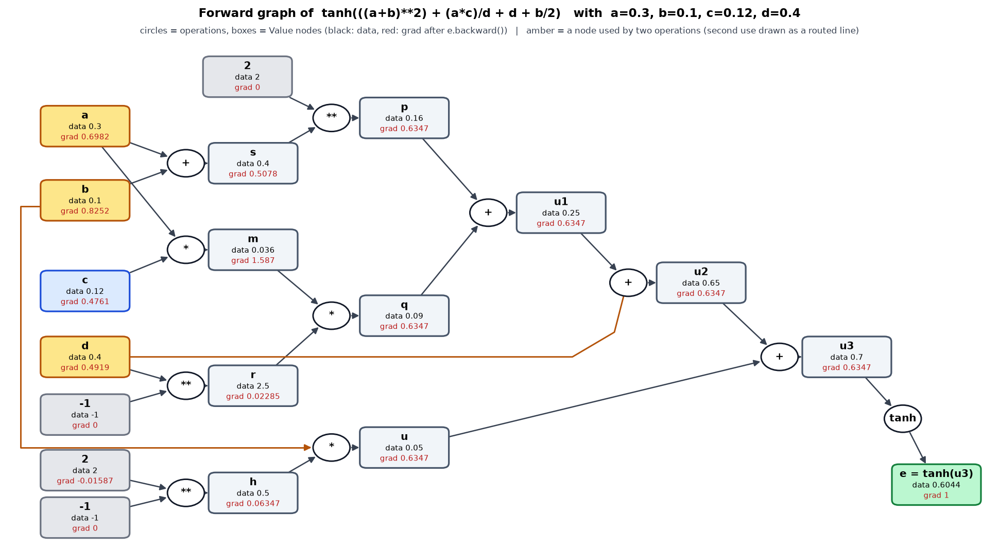

# Lecture 3 — Autograd From Scratch, the Bigram Language Model Two Ways, and the First MLP

Revision notes for Month 3 (Sessions 1–10). Read top to bottom to rebuild the whole chain from memory: derivative, graph, backward pass, a tiny training loop, bigram counts, NLL, the neural bigram, and finally the embedding-based MLP language model. The three scripts in `Month 3/` are the worked examples. Numbers are real outputs of the scripts.

**How to use these notes:** read Parts 1–14 for the ideas, Part 15 for the mistakes that commonly appear when writing this code, and Part 16 as a quiz. If an answer in Part 16 is shaky, go back to the part named beside it.

| Part | Topic | Source files |
|---|---|---|
| 1 | Derivatives as perturbation: the numerical check | [1 micrograd.py](../../Month%203/1%20micrograd.py) |
| 2 | The computation graph and the chain rule | [1 micrograd.py](../../Month%203/1%20micrograd.py) |
| 3 | The `Value` class: forward operations | [1 micrograd.py](../../Month%203/1%20micrograd.py) |
| 4 | Reverse-mode autodiff: `backward()` | [1 micrograd.py](../../Month%203/1%20micrograd.py) |
| 5 | Neuron, Layer, MLP and one training loop | [1 micrograd.py](../../Month%203/1%20micrograd.py) |
| 6 | From autograd to language modeling | [2 bigram plain.py](../../Month%203/2%20bigram%20plain.py) |
| 7 | The count-based bigram model (incl. why counts must not be FP16) | [2 bigram plain.py](../../Month%203/2%20bigram%20plain.py) |
| 8 | Negative log-likelihood and smoothing | [2 bigram plain.py](../../Month%203/2%20bigram%20plain.py) |
| 9 | The neural bigram model | [2 bigram plain.py](../../Month%203/2%20bigram%20plain.py) |
| 10 | Why the two bigram models are the same model | derivation, confirmed by the output of [2 bigram plain.py](../../Month%203/2%20bigram%20plain.py) (Part 9.6) |
| 11 | From bigram to a fixed-context MLP: windows and splits | [3 mlp.py](../../Month%203/3%20mlp.py) |
| 12 | Embeddings and the shape path | [3 mlp.py](../../Month%203/3%20mlp.py) |
| 13 | Training the MLP: mini-batches, loss, generation | [3 mlp.py](../../Month%203/3%20mlp.py) |
| 14 | Results: loss and generated names | [3 mlp.py](../../Month%203/3%20mlp.py) |
| 15 | Common pitfalls to remember | all three files |
| 16 | Self-check | Session 1–10 questions |

The thread through all of it: **training a model is one loop (forward, loss, backward, update), and a language model is a table of conditional probabilities that can be stored as counts or learned as weights.** Part 1–5 build the machinery that computes gradients. Part 6–10 give that machinery its first real task, and Part 11–14 extend it from one character of context to three, using learned embeddings (`3 mlp.py`).

---

## Part 1 — Derivatives as perturbation

A derivative answers one question: *if I nudge this input by a tiny amount, how much does the output move?*

$$\frac{\partial f}{\partial x} \approx \frac{f(x+h) - f(x-h)}{2h}$$

This is the **central difference**. It is more accurate than the one-sided `(f(x+h) - f(x))/h` because the error terms of the two sides cancel.

Start here, before any autograd, with a hand-built expression:

```python
a, b, c, d = 3, 10, 12, 4
expr = ((a+b)**2) + (a*c)/d + d + b/2        # = 187

def valuate_derivative(d1, d2, h): return (d1 - d2) / (2*h)
```

It perturbs one variable at a time by `±1e-8` and compares against a derivative worked out by hand:

| Variable | Hand derivation | Value |
|---|---|---:|
| `a` | `2(a+b) + c/d` | 29.0 |
| `b` | `2(a+b) + 1/2` | 26.5 |
| `c` | `a/d` | 0.75 |
| `d` | `-a·c/d² + 1` | -1.25 |

Each hand derivation is a sum of the contributions from every place the variable appears. `a` appears in `(a+b)²` and in `a·c/d`, so its derivative has two terms. Remember this: it is the whole reason gradients must **accumulate** in Part 4.

**Why this is not how training works.** The numerical method costs two forward passes *per parameter*. A model with 1,000,000 parameters would need 2,000,000 forward passes for one gradient. Backpropagation gets every gradient from **one** forward and **one** backward pass. The numerical method survives only as a *test*: it is an independent reference that does not share any code with your backward rules.

> **Choosing `h`.** `1e-8` is near the sweet spot for float64. Much smaller and the subtraction `f(x+h) - f(x-h)` loses all its significant digits to rounding. Much larger and the slope stops being local.

---

## Part 2 — The computation graph and the chain rule

Every arithmetic expression is a graph. For `e = a*b`, `d = e + c`, `f = tanh(d)`:

```
a ──┐
    ├─► [*] ─► e ──┐
b ──┘              ├─► [+] ─► d ─► [tanh] ─► f
              c ───┘
```

- **Leaf nodes** (`a`, `b`, `c`) are inputs or parameters. Nothing in the graph produced them.
- **Intermediate nodes** (`e`, `d`, `f`) are produced by an operation from their **children** in the script's naming, or **parents** in the curriculum's naming. Both mean the same thing: the nodes the operation consumed. This lecture says *inputs of the operation* to avoid the clash.

### The graph of `tanh(((a+b)**2) + (a*c)/d + d + b/2)`

This is the expression used in Part 1 with a `tanh` on top. Python evaluates it as `(((a+b)**2 + (a*c)/d) + d) + b/2`, and `Value` builds division and subtraction from `*` and `**` (Part 3.3), so `x / y` is really `x * y**-1`. The graph the engine builds is therefore larger than the formula suggests.

Values shown use `a=0.3, b=0.1, c=0.12, d=0.4` (the tanh run in Part 4.4):



How to read the figure: **circles are operations, boxes are `Value` nodes.** Each box shows its `data` (forward value, black) and its `grad` (red, after `e.backward()`). Arrows point from the inputs of an operation to the operation, and from the operation to the node it produces, so data flows left to right. The amber boxes `a`, `b` and `d` are each used by **two** operations. Their second use is drawn as a routed line so it does not cross other boxes: `b` also feeds the `b * h` node, and `d` also feeds the `u1 + d` addition.

The `grad` values are the gradients printed in Part 4.4. For example `a.grad = 0.6982` is the sum of two paths (through `a+b` and through `a*c`), `d.grad = 0.4919` is the sum of its direct `+ d` path and its `d**-1` path, and every node on the main chain `p, q, u1, u2, u, u3` carries the same `0.6347`, the `tanh` factor `1 - e²`.

The same graph as a table, one row per node, in the order the engine creates them (this is also forward topological order):

| Node | Operation | Inputs | Value |
|---|---|---|---:|
| `a, b, c, d` | leaves | none | 0.3, 0.1, 0.12, 0.4 |
| `s` | `+` | `a`, `b` | 0.4 |
| `p` | `**` | `s`, constant `2` | 0.16 |
| `m` | `*` | `a`, `c` | 0.036 |
| `r` | `**` | `d`, constant `-1` | 2.5 |
| `q` | `*` | `m`, `r` | 0.09 |
| `u1` | `+` | `p`, `q` | 0.25 |
| `u2` | `+` | `u1`, `d` | 0.65 |
| `h` | `**` | constant `2`, constant `-1` | 0.5 |
| `u` | `*` | `b`, `h` | 0.05 |
| `u3` | `+` | `u2`, `u` | 0.70 |
| `e` | `tanh` | `u3` | 0.6044 |

Things to notice:

- **`a`, `b` and `d` each have two outgoing edges.** `a` feeds `a+b` and `a*c`. `b` feeds `a+b` and `b/2`. `d` feeds `d**-1` and the `+ d` term. This is why the graph is a DAG, not a tree, and why `.grad` must accumulate with `+=` (Part 4.3). `c` has one edge, so it gets a single contribution.
- **Constants are nodes too.** The `2` in `**2` and in `b/2` becomes a `Value`, and `b/2` creates the extra node `h = 2**-1`. Their gradients are computed but never used.
- **The output gradient is seeded on `e`**, then flows `e → u3 → (u2, u) → ...` in reverse topological order. Each node's `_backward` runs only after all of its consumers have finished, which for `d` means after both `r` and `u2`.
- **The `tanh` node contributes the factor `1 - e² = 1 - 0.6044² ≈ 0.6347`** to every gradient. Without it the gradients are the Part 1 derivatives (`a`: `2(a+b) + c/d = 1.1`). With it, `a.grad = 1.1 × 0.6347 ≈ 0.698`, the printed `0.6982`.
- The graph is a **DAG**, not necessarily a tree. A value used twice (`x*x`) has two edges into the same node.

### The chain rule, as a local rule

You never differentiate the whole expression. Each node knows only its **local derivative**, the derivative of its own output with respect to each of its own inputs. The chain rule glues them together:

$$\underbrace{\frac{\partial L}{\partial x}}_{\text{final gradient}} \;=\; \underbrace{\frac{\partial L}{\partial \text{out}}}_{\text{upstream gradient}} \times \underbrace{\frac{\partial \text{out}}{\partial x}}_{\text{local derivative}}$$

| Operation | Local derivatives |
|---|---|
| `out = a + b` | `∂out/∂a = 1`, `∂out/∂b = 1` |
| `out = a * b` | `∂out/∂a = b`, `∂out/∂b = a` |
| `out = a ** n` | `∂out/∂a = n · a^(n-1)` |
| `out = tanh(a)` | `∂out/∂a = 1 - out²` |

Two consequences worth stating out loud:

- **Addition is a gradient router.** It passes the upstream gradient to both inputs unchanged.
- **Multiplication swaps.** Each input's gradient is scaled by the *other* input's value. This is why the forward values must be kept: backward needs them.

### Why `1 - tanh²`

`tanh(x)` has the derivative `1 - tanh²(x)`. The script reuses the forward result `tanh` rather than recomputing it, so the node's backward needs no extra `exp`. It also shows why `tanh` saturates: when `|out|` is near 1, the local derivative is near 0 and almost no gradient flows through.

---

## Part 3 — The `Value` class: forward operations

A `Value` wraps one Python number and remembers how it was made.

```python
class Value:
    def __init__(self, value, name="", children=()):
        self.value = value
        self.name = name
        self.grad = 0.0                 # d(final output)/d(this node), filled by backward
        self.children = children        # the inputs of the op that produced this node
        self._backward = lambda: None   # leaf nodes have nothing to propagate
```

| Field | Belongs to | Purpose |
|---|---|---|
| `value` | forward pass | The number itself |
| `children` | forward pass, *kept for* backward | The graph edges. Without them there is nothing to traverse |
| `_backward` | backward | A closure holding this one op's local derivative rule |
| `grad` | backward | Accumulated sensitivity of the final output |
| `name` | debugging only | A label for `repr` |

### 3.1 Coercion

```python
def _clean(self, value):
    if isinstance(value, (int, float)):
        value = Value(value)
    return value
```

This is what makes `a + 2` and `b / 2` work. A bare number becomes a leaf `Value` with no name. Note that `np.float64` is a subclass of Python `float`, so NumPy scalars also pass.

### 3.2 Addition and multiplication

Each operation does three things: compute the forward value, record the inputs, and attach a closure.

```python
def __add__(self, other):
    other = self._clean(other)
    out = Value(self.value + other.value, children=(self, other))

    def backward():
        self.grad  += 1.0 * out.grad
        other.grad += 1.0 * out.grad

    out._backward = backward
    return out

def __mul__(self, other):
    other = self._clean(other)
    out = Value(self.value * other.value, children=(self, other))

    def backward():
        self.grad  += other.value * out.grad
        other.grad += self.value  * out.grad

    out._backward = backward
    return out
```

**Why a closure.** `backward` is defined *inside* the operator, so it captures `self`, `other` and `out` exactly as they were. The node carries its own derivative rule with no lookup table and no operation-type switch.

### 3.3 Everything else is built from those two

| Operator | Built as | Cost |
|---|---|---|
| `a - b` | `a + (b * -1)` | No new backward rule |
| `a / b` | `a * b**-1` | Needs `__pow__` |
| `2 + a` (`__radd__`) | `a + 2` | Addition commutes |
| `3 * a` (`__rmul__`) | `a * 3` | Multiplication commutes |

Building subtraction and division from primitives means they are correct **for free**. You write two backward rules for `+` and `*`, one for `**`, and everything else inherits them.

### 3.4 Power and tanh

```python
def __pow__(self, other):
    other = self._clean(other)
    out = Value(self.value ** other.value, children=(self, other))
    def backward():
        self.grad += other.value * (self.value ** (other.value - 1)) * out.grad
    out._backward = backward
    return out
```

The exponent is treated as a constant. Only `self.grad` is updated, so `other.grad` stays 0. That is the right choice for `x**2` or `x**-1`, but it would be wrong for a variable exponent like `2**x`.

```python
def tanh(self):
    x = self.value
    tanh = (math.exp(2*x) - 1) / (math.exp(2*x) + 1)
    out = Value(tanh, children=(self,))
    def backward():
        self.grad += (1 - tanh**2) * out.grad
    out._backward = backward
    return out
```

`tanh` is a leaf-like primitive here: one input, and a local derivative that reuses the forward result.

---

## Part 4 — Reverse-mode autodiff: `backward()`

```python
def backward(self):
    self.grad = 1.0
    visited, nodes = set(), []

    def topo(node):
        if node not in visited:
            visited.add(node)
            for child in node.children:
                topo(child)
            nodes.append(node)       # appended AFTER all its inputs

    topo(self)
    for node in reversed(nodes):
        node._backward()
```

Three decisions, each with a reason.

### 4.1 Seed the output with 1

`self.grad = 1.0` encodes `∂L/∂L = 1`. Every other gradient is a product that starts from this. If you seeded 0, every gradient in the graph would be 0. It is a *seed*, not a loss value.

### 4.2 Topological order, then reverse

The depth-first `topo` appends a node only after all of its inputs. So `nodes` is ordered **inputs first, output last**. That is forward evaluation order.

Backward must go the other way. A node may call `_backward()` only after **every** consumer of it has already pushed its contribution into `node.grad`. Reversed topological order guarantees that: every consumer comes before the node in the reversed list.

```
Forward order:   a, b, e, c, d, f
Backward order:  f, d, c, e, b, a      # f pushes into d, d into e and c, e into a and b
```

If you ran backward in forward order, `a._backward()` would run first with `a.grad` still 0 and push nothing, and `f` would run last, too late for anyone to use it. This is Assignment M3.3's second deliberate failure.

The `visited` set also matters for another reason. A node reachable through two paths must be added to `nodes` **once**. `Value` defines no `__eq__` or `__hash__`, so the set compares by object identity, which is exactly what is wanted.

### 4.3 Accumulate with `+=`

Look back at the first derivative table. `a` contributes through two paths, and its derivative is the **sum**. The graph does the same:

```python
y = x + x          # x has two edges into the same node
```

Each of the two edges runs `x.grad += 1.0 * y.grad`. With `+=` you get 2, which is correct. With `=` the second edge overwrites the first and you get 1.

This is the multivariable chain rule: when a value influences the output through several routes, the total effect is the sum of the effects along each route.

> **Check:** `y = Value(2.0); z = y + y; z.backward()` gives `y.grad = 2.0`.

### 4.4 Checking it

Running the first graph (`a=3, b=10, c=12, d=4`) gives:

```
a.grad = 29.0    b.grad = 26.5    c.grad = 0.75    d.grad = -1.25
```

These are the same four numbers as the hand derivation and the central-difference estimate in Part 1. Three independent methods agreeing is the test.

The second graph wraps the expression in `tanh`:

```python
a, b, c, d = Value(0.3), Value(0.10), Value(0.12), Value(0.4)
e = (((a+b)**2) + (a*c)/d + d + b/2).tanh()
e.backward()
# a.grad=0.6982  b.grad=0.8252  c.grad=0.4761  d.grad=0.4919  e.grad=1.0000
```

Every gradient is the Part 1 style derivative multiplied by `1 - tanh²(expr)`. That single factor is the upstream gradient arriving from the `tanh` node.

### 4.5 Calling `backward()` twice

`grad` is never reset inside `backward()`. The root is reseeded to 1.0, but every other node keeps what it had and adds again, so a second call **doubles** their gradients. Gradients must be cleared by the caller. That is the job of `zero_grad()` in Part 5.

### 4.6 What is scalar-specific

Everything here is one number per node. A tensor engine like PyTorch keeps the same four ideas (graph, local rule, reverse order, accumulation) and changes only what a node holds: an array, with a local rule that works on arrays. The algorithm is identical.

---

## Part 5 — Neuron, Layer, MLP and one training loop

### 5.1 The three classes

```python
class Neuron:
    def __init__(self, nin):
        self.w = [Value(v) for v in np.random.uniform(-1, 1, size=nin)]
        self.b = Value(np.random.uniform(-1, 1))
    def __call__(self, x):
        wx  = sum(wi*xi for wi, xi in zip(self.w, x))     # sum() starts at int 0: needs __radd__
        return (wx + self.b).tanh()
    def parameters(self): return self.w + [self.b]
```

| Class | Holds | Output |
|---|---|---|
| `Neuron(nin)` | `nin` weights and 1 bias | one `Value`: `tanh(w·x + b)` |
| `Layer(fin, fout)` | `fout` neurons, each with `fin` inputs | a list of `fout` Values |
| `MLP([n0, n1, ..., nk])` | one `Layer` per consecutive pair | the last layer's list, or a single `Value` if it has width 1 |

`MLP([3, 4, 4, 1])` builds layers `3→4`, `4→4`, `4→1`. The parameter count is `(3·4+4) + (4·4+4) + (4·1+1) = 16 + 20 + 5 = 41`. Each neuron has `nin + 1` parameters.

**What makes a number a parameter.** A weight or bias is a `Value` that **you** created and that **you** update. An activation is a `Value` produced by an operation. Both are nodes in the graph. Only the first set is returned by `parameters()` and changed by the update step.

**Why a bias.** Without it every neuron's output is forced to be 0 when all inputs are 0, so the decision surface must pass through the origin. The bias shifts it.

**Why a nonlinearity.** Two stacked linear layers compute `W2(W1 x) = (W2 W1) x`, which is one linear layer. `tanh` between layers is what lets depth add expressive power.

### 5.2 The training loop

```python
model = MLP([features, 4, 4, 1])
for i in range(epochs):
    model.zero_grad()                                    # 1. clear old gradients
    ypred = [model(x) for x in xs]                       # 2. forward
    loss  = sum([(yp - yt)**2 for yp, yt in zip(ypred, ys)])   # 3. loss
    loss.backward()                                      # 4. backward
    for p in model.parameters():                         # 5. update
        p.value += -0.01 * p.grad
```

The five steps to be able to write from memory: **forward, loss, zero, backward, update.** `zero_grad` may come first or right after the loss. Either works as long as it comes before `backward`.

Three things to understand about this loop:

- **The graph is rebuilt every iteration.** `model(x)` constructs fresh intermediate nodes each time. What persists across iterations is only the parameter *values*. So training changes the parameters and never the graph structure.
- **The update is outside the graph.** `p.value += ...` edits a plain number. It is not a `Value` operation, so it creates no node and has no gradient. If it were inside the graph, the next backward pass would differentiate through the optimizer.
- **The sign.** Gradient descent moves *against* the gradient, hence `-0.01 * p.grad`. The gradient points toward increasing loss.

### 5.3 What this particular run is, and is not

The data is `xs = randn(5, 4)` and `ys = randn(5)`: **random noise with random targets.** That is fine for checking that the machinery runs and that loss falls as the model memorizes 5 points. It proves nothing about learning a pattern. The curriculum's M3.4 asks for a real tiny dataset (XOR or two moons) and a PyTorch parity check. Two limits to keep in mind:

- The last layer ends in `tanh`, so predictions live in `(-1, 1)`, but `randn` targets can fall outside that range. The loss can therefore never reach 0 for those points.
- The loss is a **sum**, not a mean. Its scale grows with dataset size, which changes how large a learning rate is safe.

---

## Part 6 — From autograd to language modeling

The bigram work changes the question. Instead of fitting numbers, it models **text**: given the characters so far, what comes next?

A language model estimates a conditional distribution over the next token. For a whole sequence, the chain rule of probability factorizes it:

$$P(x_1, \dots, x_n) = \prod_{t=1}^{n} P(x_t \mid x_1, \dots, x_{t-1})$$

A **bigram** model makes one simplifying assumption: only the previous token matters.

$$P(x_t \mid x_1, \dots, x_{t-1}) \approx P(x_t \mid x_{t-1})$$

What is lost: everything before the previous character. A bigram model sees `n` and cannot tell whether it came from `ann`, `kin` or `zan`.

### 6.1 The data

`names.txt` holds **32,033 names**. Each name is wrapped in boundary tokens:

```python
word = [eow] + list(word) + [eow]          # eow = "."
for c1, c2 in zip(word, word[1:]):          # every adjacent pair
    ...
```

For `emma` this produces the pairs: `(. e) (e m) (m m) (m a) (a .)`: `len(word) + 1` pairs. Over the corpus that is **228,146 pairs**, which is `sum(len(w) + 1)`.

`.` appears as an **input** in `(. e)` (what starts a name) and as a **target** in `(a .)` (what ends one). One symbol serves both roles, so the model learns when to stop as well as what to say.

### 6.2 The vocabulary

```python
chars = [eow] + list(sorted(chars)[1:])      # '.' first, then a..z
stoi  = {c: i for i, c in enumerate(chars)}
itos  = {i: c for i, c in enumerate(chars)}
```

`sorted` places `.` (ASCII 46) before `a` (ASCII 97), so `sorted(chars)[1:]` drops it, and it is put back at index 0. The result is `V = 27`: `.` → 0, `a` → 1, … `z` → 26. `stoi` and `itos` are inverses of each other.

A token ID is just an integer. It carries no meaning, no distance, no ordering. Part 9 turns it into a vector.

---

## Part 7 — The count-based bigram model

### 7.1 Counting

```python
bigram_matrix = torch.zeros((27, 27), dtype=torch.float32)
for (c1, c2), value in pairs.items():
    bigram_matrix[stoi[c1], stoi[c2]] = value
```

**Axes.** Row `i` = the previous character. Column `j` = the next character. `N[i, j]` = how many times `j` followed `i`. For example `pairs[('.', 'a')] = 4410`: 4,410 names start with `a`.

**Where the memory lives.** The whole model is these `27 × 27 = 729` numbers. There are no other parameters.

### 7.1b Gotcha: counts stored in FP16 silently change (`4410` → `4408`)

The Python dict counts `('.', 'a')` correctly as `4410`. But if the matrix is created with `dtype=torch.float16`, this line rounds the value on assignment:

```python
bigram_matrix[stoi[c1], stoi[c2]] = value      # 4410 is stored as 4408.0
```

This is a real change to the stored number, not a display issue. It is not an error, so nothing warns you.

**Why it happens: range is not precision.** FP16 can reach `65504`, but it cannot store every integer on the way there. A float is `(1.fraction) × 2^e` and FP16 keeps only **10 fraction bits** (11 significant binary digits including the implicit leading 1). So the gap between neighbouring representable numbers is fixed by the exponent:

$$\text{spacing} = 2^{e-10}$$

Every time the exponent goes up by one, the spacing **doubles**.

| Range | Exponent `e` | Spacing | Meaning |
|---|---:|---:|---|
| up to 2048 | ≤ 10 | ≤ 1 | every integer is exact |
| 2048 – 4096 | 11 | 2 | only even integers |
| **4096 – 8192** | **12** | **4** | only multiples of 4 |
| 8192 – 16384 | 13 | 8 | only multiples of 8 |

`4410` sits in 4096–8192, so the representable neighbours are `4404, 4408, 4412, 4416`. `4410` is exactly halfway between `4408` and `4412`.

**Which neighbour wins: round to nearest, ties to even.** On a tie, pick the value whose last stored *bit* is 0. This is about the binary fraction, not the decimal number. In units of the spacing (4):

```
4408 = 1102 × 4   -> 1102 even  -> chosen
4412 = 1103 × 4   -> 1103 odd
4410 -> 4408

4414 is also a tie:  4412 = 1103 × 4 (odd),  4416 = 1104 × 4 (even)  ->  4414 -> 4416
```

So rounding does not always go down. (Both candidates are even decimals, which is why "even" is easy to misread.)

**The bits, step by step**

```
4410           = 1000100111010₂
normalize      = 1.000100111010₂ × 2¹²           e = 12
fraction       = 000100111010   keep 10 bits: 0001001110, discard "10"
discarded "10" = exactly half; last kept bit is 0 (even) -> do not round up
exponent field = e + 15 (bias) = 27 = 11011₂
stored         = 0 | 11011 | 0001001110           (sign | exponent | fraction)
```

Decode to check: fraction `0001001110` = 78, so `4096 × (1 + 78/1024) = 4096 + 312 = 4408`. ✔

Discard rule in one line: discarded bits start with `0` → leave as is; start with `1` and anything follows → round up; exactly `1000…` → round up only if the last kept bit is 1.

**The fix: count in integers, normalize in FP32.**

```python
bigram_matrix = torch.zeros((V, V), dtype=torch.int64)   # exact counts
...
counts = bigram_matrix.to(torch.float32)                 # then probabilities
```

FP32 has 23 fraction bits, so it stores every integer exactly up to 2²⁴ = 16,777,216, which is far above any count here. This is the same precision-versus-range split as Lecture 2 Part 3, seen on a real number from the dataset. It is also a small version of why AMP keeps accumulations and optimizer state in FP32.

> **Rule to remember:** FP16 is exact for integers only up to **2048**. Anything larger can be off by 1, 2, 4, 8… depending on its size. Never store counts or running totals in FP16.

Check: `torch.tensor(4410.).half()` gives `4408.0`, and `torch.tensor(4414.).half()` gives `4416.0`.

### 7.2 Normalizing: each row becomes a distribution

```python
N = bigram_matrix + 1.0
N = N / N.sum(dim=1, keepdim=True)
```

`dim=1` sums **across the columns of each row**: it totals all possible next characters for one previous character. Dividing gives:

$$P(y \mid x) = \frac{N_{x,y} + \alpha}{\sum_j (N_{x,j} + \alpha)}$$

Every row now sums to 1. `keepdim=True` leaves the sum with shape `[27, 1]`, so it **broadcasts** across columns. Without it the shape would be `[27]` and PyTorch would try to align it with the *last* axis, dividing each column by the wrong total with no error raised.

> **The wrong-axis bug.** `N.sum(dim=0)` (or `keepdim=False`) normalizes each *column*. The result is `P(previous | next)`: a legitimate distribution of a different kind, but generation would sample the wrong thing. This is Assignment M3.6's deliberate failure. Check with `P.sum(1)` which should be all ones.

### 7.3 Sampling

```python
g = torch.Generator().manual_seed(MANUAL_SEED)       # 2147483647

for i in range(5):
    out, idx = [], 0                                 # start at '.'
    while True:
        idx = torch.multinomial(N[idx], num_samples=1, replacement=True, generator=g).item()
        if idx == 0:                                 # sampled '.', the name is over
            break
        out.append(itos[idx])
    print("".join(out))
```

This is **autoregressive generation**: sample a character from row `idx`, then feed that character back in as the next row index. Each output depends on the previous output, which is why generation is a sequential loop even though training can be computed in parallel.

Two points:

- The dedicated `torch.Generator` makes sampling repeatable without touching global random state.
- The generator is **stateful**. Every `multinomial` call on `g` consumes random numbers, even one whose result is never used (for example a quick test draw of 100 samples before the loop). Adding or removing such a call changes every later name. Reproducibility is "same seed *and* same sequence of calls". Reset with a fresh `manual_seed` to restart the sequence.

---

## Part 8 — Negative log-likelihood and smoothing

### 8.1 Derivation

How well does the model explain the real data? Multiply the probability it assigned to every observed pair:

$$\text{likelihood} = \prod_{m=1}^{M} P(y_m \mid x_m)$$

This product is hopeless numerically: 228,146 numbers below 1 multiplied together underflows to 0. Take the log, which turns the product into a sum:

$$\text{log-likelihood} = \sum_m \log P(y_m \mid x_m)$$

A higher likelihood is better, but optimizers minimize. Negate it, and divide by `M` so the number does not depend on dataset size:

$$\text{NLL} = -\frac{1}{M} \sum_{m=1}^{M} \log P(y_m \mid x_m)$$

Lower NLL means the model assigned **more probability to what actually happened.**

### 8.2 In code

```python
log_likelihood, count = 0.0, 0
for word in words:
    word = [eow] + list(word) + [eow]
    for c1, c2 in zip(word, word[1:]):
        log_likelihood += torch.log(N[stoi[c1], stoi[c2]])
        count += 1
nll = -log_likelihood / count          # 2.4543561935424805 for the count model with alpha = 1
```

Walk every adjacent pair, look up the probability the model gave it, add its log, then average. A variable name such as `nll` is reused for the count model and the neural model, so inspect or print it right after computing it, before it is overwritten.

### 8.3 A reference point: the uniform model

A model with no knowledge gives every character probability `1/V`. Its per-token NLL is exactly `-log(1/V) = log(V)`:

$$\log 27 = 3.296$$

Any model that cannot beat 3.296 has learned nothing.

### 8.4 Effect of smoothing

The script adds `α = 1` to every count before normalizing (`N = bigram_matrix + 1.0`), which gives the NLL of **2.4543561935424805** above. What `α` does:

1. **`α = 0` leaves zero-probability cells.** A pair that never occurs in training has count 0, so its probability is 0 and `log(0)` is `-inf`. Such a pair costs nothing on the training data, because training only evaluates pairs that exist, but any new name containing it gets probability 0, which is NLL = ∞. Training NLL cannot see this problem. A held-out set can.
2. **Larger `α` pulls every row toward uniform.** With a huge `α` the pseudo-counts swamp the real counts, each row becomes `1/27`, and NLL approaches the uniform value `log 27 = 3.296` (Part 8.3).
3. **A small `α` is cheap insurance.** When real counts are in the thousands, adding 1 barely moves the probabilities, but it removes every zero.

The NLL here is a *training* NLL. Choosing `α` properly needs a held-out split, which arrives with the MLP.

### 8.5 A good NLL, a strange name

Average NLL measures how well the *probabilities* match the data. It does not promise that every sampled sequence looks right. A bigram model has no memory beyond one character, so it happily samples locally plausible, globally strange names.

---

## Part 9 — The neural bigram model

### 9.1 The same task, as a one-layer network

Instead of reading a table, **learn** a table with gradient descent.

```python
xenc   = torch.nn.functional.one_hot(xs, num_classes=27).float()   # [M, 27]
logits = xenc @ w                                                  # [M, 27]
counts = logits.exp()                                              # [M, 27]
prob   = counts / counts.sum(dim=1, keepdim=True)                  # [M, 27], rows sum to 1
nll    = -prob[torch.arange(xenc.shape[0]), ys].log().mean() \
         + 0.01 * (w**2).mean()                                    # scalar: NLL + L2 penalty
```

| Tensor | Shape | Meaning |
|---|---|---|
| `xs` | `[M]` | Input character IDs |
| `ys` | `[M]` | Target character IDs |
| `xenc` | `[M, 27]` | One-hot inputs |
| `w` | `[27, 27]` | Learnable weights, initialized `randn` from the seeded generator |
| `logits` | `[M, 27]` | One real-valued score per possible next character |
| `prob` | `[M, 27]` | The softmax of the logits |
| `nll` | `[]` | Mean negative log-likelihood, plus the L2 penalty `0.01 * mean(w²)` |

### 9.2 The one-hot multiplication is row selection

`xenc` has a single 1 per row. For input character `c`, `xenc[i] @ w` is `1·w[c, :] + 0·(everything else)`, which is **row `c` of `w`**. A matrix multiply here is a table lookup in disguise. Each row of `w` is the vector of next-character scores for one previous character.

### 9.3 Logits, exp, and softmax

Raw logits can be negative or large. They are not probabilities. The two steps make them probabilities:

- `exp` makes every value positive. By the earlier analogy, it plays the role of the *count*: `exp(logit) ↔ N[x, y]`.
- Dividing by the row sum makes each row total 1. This is exactly the Part 7 normalization.

The pair is called **softmax**.

> **Indexing the target.** `prob[torch.arange(M), ys]` picks, for each example `i`, the probability the model gave to the correct next character, `prob[i, ys[i]]`. That is the `P(y_m | x_m)` in the NLL formula. `torch.arange` supplies the row index, `ys` supplies the column index.

### 9.4 The training loop

```python
w = torch.randn((27, 27), requires_grad=True, generator=g)
for i in range(100):         # 100 steps is enough to learn the count table's distribution
    ... forward ...
    w.grad = None            # clear
    nll.backward()           # PyTorch's autograd: Part 4, with tensors
    w.data += -50 * w.grad   # update, outside the graph
```

This is the same five-step loop as Part 5, now over a `27 × 27` tensor. `w.grad = None` is the clear step. `w.data += ...` is the update that stays outside the graph. `loss.backward()` is the engine you built, scaled up to tensors.

`lr = 50` looks huge, but it is reasonable here: the loss is a *mean* over 228,146 examples, so each gradient entry is tiny, and the problem is a single shallow layer. A learning rate that works for one loss scale is not portable to another (for example a *sum* loss would need a far smaller one).

**Sampling from the learned model** feeds each sampled character back in, exactly like the count model, but the row comes from a forward pass instead of a table lookup:

```python
g = torch.Generator().manual_seed(MANUAL_SEED)           # reset: same random stream as the count sampler
for i in range(5):
    out, idx = [], 0
    while True:
        xt    = torch.nn.functional.one_hot(torch.tensor([idx]), num_classes=27).float()
        logit = (xt @ w).exp()
        probs = logit / logit.sum(dim=1, keepdim=True)   # [1, 27] next-character distribution
        idx   = torch.multinomial(probs, num_samples=1, replacement=True, generator=g).item()
        if idx == 0:
            break
        out.append(itos[idx])
    print("".join(out))
```

### 9.5 Training settings, and how to read the loss

The setup: **all 228,146 pairs**, **100 steps**, `lr = 50`, and an L2 term `0.01 * (w**2).mean()` added to the loss. The printed loss therefore includes the penalty. It is not the pure NLL, and it sits slightly above it. To compare with the count model's NLL exactly, compute the pure NLL separately.

Only losses on the same data can be compared. A loss on a handful of words and a loss on the whole corpus are different quantities. Watching the loss fall is the main debugging signal: print it every few steps, or in an interactive session simply evaluate the variable.

### 9.6 Result: the neural bigram and the count bigram give almost the same output

The printed losses and the five sampled names (same seed for both) are:

**Losses**

```
count-based model   nll loss = 2.4543561935424805
neural model        nll loss = 2.490130662918091     (includes the 0.01 * mean(w²) L2 term)
```

**Count-based model's output**

```
cexze
momasurailezitynn
konimittain
llayn
ka
```

**Neural model's output**

```
cexze
momasurailezityha          <- only the last 2 letters differ (tynn vs tyha)
konimittain
llayn
ka
```

**The training trajectory.** The neural model starts at a loss of **3.7686** (random weights) and falls to **2.4901** after 100 steps, converging toward the count model's **2.4544**. It never sees the count table: gradient descent alone finds a nearly identical distribution.

Two things to read from the starting value:

- **3.7686 is worse than the uniform baseline `log 27 = 3.296` (Part 8.3).** `w` is `randn`, so its logits have a spread of about 1, and the softmax is confidently wrong in random directions. A model that is confidently wrong is penalized more than one that knows nothing. Early training first removes this damage, then learns real structure.
- **The start is a sanity check.** A starting loss near `log V` is expected. A start that is wildly larger would suggest a problem with the initialization or the loss code.

The neural loss ends slightly higher than the count model's. Two reasons: the printed value includes the L2 penalty, and 100 steps of gradient descent only approach the optimum that counting reaches exactly.

Four of five names are character-for-character identical, and the fifth differs in two letters. This is the expected result, not a coincidence or a bug. There are two separate reasons, and it is worth keeping them apart.

**Reason 1: the distributions really are nearly the same (Part 10).** Both models are a `27 × 27` table of next-character distributions. The neural one *learned* its table by gradient descent and ends close to the counted one. Because the count model is the exact optimum of the unregularized objective, a gradient-descent model that has not fully converged, and that carries an L2 penalty, cannot beat it. The loss ordering (2.4544 below 2.4901) is the expected direction.

**Reason 2: both samplers use the same seed (this is why the *names* match so closely).** `torch.multinomial` draws a random number and picks the character whose slice of the cumulative distribution contains it. The generator is reset with `g = torch.Generator().manual_seed(MANUAL_SEED)` before the neural sampling loop, so both loops receive **the same sequence of random numbers**. If two distributions differ slightly, the same random number lands in the same slice almost every time, and the same letter is picked. The two models only diverge when a random number falls into the thin gap between the two cumulative boundaries, which is what happened at the end of name 2.

So *identical samples are weak evidence that two models agree.* They show the two distributions are close at the points where the draws landed. The losses are the real comparison.

**A subtlety about when the outputs stay aligned.** Both runs use the generator one draw per generated character. In name 2 the two models chose different letters, but both names were the same length, so the generator was consumed by the same number of draws and names 3 to 5 stayed in sync. If the two names had come out different *lengths*, every later name would have shifted out of alignment and looked completely different. Do not read a mismatch in later names as a model difference.

**What this tells you.**

- The count model and the one-layer neural model represent the same family of distributions, and training finds nearly the same member (Part 10).
- A one-layer network on a one-character context cannot be better than the count table. Both models *only see the previous character*. The samples look like names that are almost right (`llayn`, `ka`, `cexze`) for the same reason both times: the limit is the bigram assumption, not the optimizer. Only a longer context (the MLP) can improve this.
- To compare the two models you do not need the samples at all. Compare the NLL on the same pairs, and compare the two probability tables directly.

**Quick check to run after training** (a Session 7 equivalence test): compare the neural table with the count table.

```python
P = torch.softmax(w.detach(), dim=1)                    # neural probabilities, rows sum to 1
print((P - N).abs().max(), (P - N).abs().mean())        # table-to-table gap
print(-P[xs, ys].log().mean())                          # NLL without the L2 term
```

---

## Part 10 — Why the two bigram models are the same model

This is the key idea of Session 7. The count model is a table `P[x, y]`. The neural model computes `softmax(W[x, :])`.

The softmax of a row is `exp(W[x,y]) / Σⱼ exp(W[x,j])`. Compare with the smoothed count formula:

$$P(y \mid x) = \frac{N_{x,y} + \alpha}{\sum_j (N_{x,j} + \alpha)}$$

Set `W[x, y] = log(N[x, y] + α)`. Then `exp(W[x, y]) = N[x, y] + α` and the two expressions are identical. So the neural model **can represent exactly the same family of distributions** as the count model:

```python
W = P.log()                    # P: the smoothed count probabilities
softmax(one_hot(x) @ W)        # equals P[x, :]   (exact by algebra. How close a *trained* model gets to P is seen in Part 9.6)
```

The two differ only in **how the parameters are found**:

| | Count model | Neural bigram |
|---|---|---|
| Parameters | 729 counts | 729 weights |
| How set | Counted in one pass | Gradient descent over many steps |
| Optimum | Closed form | The same distribution, approached iteratively |

Neither is smarter. The neural version matters because gradient descent scales to models where no closed form exists: the MLP, and later the transformer.

### Smoothing and regularization are the same instinct

Adding `α` to every count pulls every row toward uniform. In the neural model, adding a penalty like `λ · mean(W²)` pulls `W` toward 0. When all of a row's logits are equal, softmax is uniform. So **L2 regularization on `W` pushes the model toward uniform probabilities, exactly like smoothing does.** A bigger `λ` corresponds to a bigger `α`.

### The stable loss

The hand-written path above uses explicit `exp`, division, indexing and `log`. That is for learning. Real code calls `F.cross_entropy(logits, ys)`, which takes **raw logits** and fuses log-softmax with NLL using the log-sum-exp trick. The hand-written path overflows if any logit is large, since `exp(100)` is already `inf` in float32. Never apply softmax before `F.cross_entropy`, or the loss is computed on a distribution that was normalized twice.

---

## Part 11 — From bigram to a fixed-context MLP

### 11.1 What the bigram cannot do

A bigram model sees one previous character. After `n` it cannot tell `ann` from `kin`. The fix is a longer **context window** of `block_size = 3` previous characters.

A count table over three characters would need `27³ = 19,683` rows, and most contexts would never be seen. The MLP avoids this by turning each character into a short learned vector and letting a small network combine the three vectors. Similar contexts then share parameters instead of each needing its own row.

### 11.2 Building context windows

```python
nchars, block_size = len(chars), 3

xs, ys = [], []
for word in words:
    word = [eow] + list(word) + [eow]                 # one leading '.' and one trailing '.'
    for i in range(len(word) - block_size):
        tx = [stoi[s] for s in word[i:i+block_size]]  # 3 context characters
        ty = stoi[word[i+block_size]]                 # the character that follows
        xs.append(tx); ys.append(ty)
xs, ys = torch.tensor(xs), torch.tensor(ys)           # xs: [M, 3], ys: [M]
```

For `emma` the padded word is `. e m m a .` (6 characters), so the loop runs `6 - 3 = 3` times:

```
[. e m] -> m
[e m m] -> a
[m m a] -> .
```

Each name gives `len(name) - 1` examples. Because only one `.` is added at the start, the first letter `e` and the second letter `m` are never targets, and a context made of three boundary tokens `[. . .]` never appears in the data. The generation loop (13.5) starts from `[0, 0, 0]`, which is exactly that context.

For comparison, padding with `block_size` leading `.` characters gives `len(name) + 1` examples per name, and every letter of the name is a target.

### 11.3 Train, dev and test

```python
n  = xs.shape[0]
n1 = int(n * 0.8)
n2 = n1 + int(n * 0.1)

xtrain, ytrain = xs[0:n1],  ys[0:n1]
xdev,   ydev   = xs[n1:n2], ys[n1:n2]
xtest,  ytest  = xs[n2:n],  ys[n2:n]
```

The roles never change: **train** updates parameters, **dev** chooses hyperparameters, **test** is looked at once at the very end.

How this split is made:

- It slices the list of **examples** (windows), not the list of words.
- It does **not shuffle**, so dev and test are the last 20% of the examples in the order they appear in `names.txt`.

Splitting by word first, after shuffling, keeps all windows of a name in one split and makes the three sets comparable. `xdev` and `xtest` are used for the held-out losses in Part 13.4.

---

## Part 12 — Embeddings and the shape path

### 12.1 An embedding table is row selection

```python
emb_size = 10
C = torch.randn(size=(nchars, emb_size))        # [27, 10]
C[[0, 0, 1]].view(-1).shape                     # torch.Size([30])
```

`C` has one row per character. Indexing it with a list or tensor of IDs returns those rows. `C[[0, 0, 1]]` is three 10-vectors, and `.view(-1)` lays them end to end: 30 numbers. With a batch, `C[xdata]` has shape `[B, 3, 10]`.

This is the same row selection as `one_hot(x) @ W` in Part 9.2, done directly without building the one-hot matrix. It is far cheaper when the vocabulary is large.

Embeddings are **learned**. A token ID is an arbitrary integer with no meaning. Training moves the rows of `C` so that characters that behave alike end up near each other. The script plots the first two embedding dimensions with `plt.scatter`, labelling each point with its character, to look at this.

### 12.2 Flattening keeps position

```python
embed = C[xdata].view(-1, block_size * emb_size)      # [B, 30]
```

The three 10-vectors are joined side by side. Numbers 0–9 always come from the oldest character, 10–19 from the middle one, and 20–29 from the newest, so position is kept by where each embedding sits. Flattening has no parameters. It only reinterprets the same numbers. `view` needs contiguous memory, which an indexing result has.

### 12.3 The shape ledger

Values from the script: `B = batch_size = 8`, `T = block_size = 3`, `emb_size = 10`, hidden width `200`, `V = nchars = 27`.

| Tensor | Shape | Role |
|---|---|---|
| `xdata` | `[8, 3]` | Context character IDs |
| `C` | `[27, 10]` | Parameter: embedding table |
| `C[xdata]` | `[8, 3, 10]` | Activation |
| `embed` (flattened) | `[8, 30]` | Activation, no parameters |
| `W1` | `[30, 200]` | Parameter, first dimension is `T * emb_size` |
| `b1` | `[200]` | Parameter |
| `l1 = embed @ W1 + b1` | `[8, 200]` | Hidden pre-activation |
| `h1 = l1.tanh()` | `[8, 200]` | Hidden activation, values in (-1, 1) |
| `W2` | `[200, 27]` | Parameter |
| `b2` | `[27]` | Parameter |
| `logits = h1 @ W2 + b2` | `[8, 27]` | One score per next character |
| `ydata` | `[8]` | Target IDs |
| `loss` | `[]` | Scalar |

Parameter count: `270 + 6000 + 200 + 5400 + 27 = 11,897`.

Why `W1` is `[T*emb_size, 200]`: a longer context grows only the **first** weight matrix. With `T = 6` it would be `[60, 200]`, and the rest of the network is unchanged.

**Gradients reach only the selected rows of `C`.** Backward through `C[xdata]` adds each position's gradient into the row that was indexed. Rows of characters absent from the batch get zero. A character that appears twice in a batch gets both contributions *added*, the same accumulation rule as Part 4.3.

---

## Part 13 — Training the MLP

### 13.1 Parameters and initialization

```python
g  = torch.Generator().manual_seed(MANUAL_SEED)       # MANUAL_SEED = 42

C  = torch.randn(size=(nchars, emb_size), requires_grad=True)
W1 = torch.randn(size=(emb_size * block_size, 200), requires_grad=True, generator=g)
b1 = torch.randn(size=(200,), requires_grad=True, generator=g)
W2 = torch.randn(size=(200, nchars), requires_grad=True, generator=g)
b2 = torch.randn(size=(nchars,), requires_grad=True, generator=g)

params = [C, W1, b1, W2, b2]
```

Everything is `randn` (standard deviation 1). Note that `C` is created without `generator=g`, so it comes from the global random state and is not covered by the seed. Likewise `torch.randint`, used for mini-batches, is not seeded. Two runs of the script will therefore give different numbers unless `torch.manual_seed` is also set.

### 13.2 The training loop

```python
epochs, batch_size = 200000, 8
loss_fn = CrossEntropyLoss()
losses = []

for epoch in range(epochs):
    for param in params:
        param.grad = None                                  # zero

    idx   = torch.randint(low=0, high=xtrain.shape[0], size=(batch_size,))
    xdata, ydata = xtrain[idx], ytrain[idx]                # random mini-batch

    embed  = C[xdata].view(-1, block_size * emb_size)
    l1     = embed @ W1 + b1
    h1     = l1.tanh()                                     # nonlinearity between the layers
    logits = h1 @ W2 + b2

    loss = loss_fn(logits, ydata)                          # raw logits, no softmax
    losses.append(loss.item())
    loss.backward()

    lr = 0.1 if epoch < 100000 else 0.01                   # step decay: big steps first, then small
    for param in params:
        param.data += -lr * param.grad                     # update, outside the graph
```

The same five steps as Part 5.2, with one new ingredient: the **mini-batch**. Each step uses 8 random examples out of the training split instead of all of them. A step is cheap, and its gradient is a noisy estimate of the full gradient that points the right way on average.

`CrossEntropyLoss` takes raw logits. It applies log-softmax internally, so softmax must not be applied first (Part 10).

**Mini-batch loss is noisy.** With 8 examples per step, one step's loss swings widely. The script therefore groups the losses and averages them:

```python
group_count = 1000
avg_losses = torch.tensor(losses).view(-1, group_count).sum(dim=1, keepdim=True) / group_count
plt.plot(avg_losses)
print(avg_losses[-1])
```

`view(-1, 1000)` turns the 200,000 losses into 200 rows of 1000, and averaging each row gives 200 points for the plot. `avg_losses[-1]` is the average training mini-batch loss over the **last 1000 steps**. It is a training signal, not a dev or test loss. The dev and test losses are computed separately in Part 13.4.

### 13.3 Two things to know about this loop

- **A nonlinearity must sit between the layers.** The first version of the forward pass was `l1 = embed @ W1 + b1`, then `logits = l1 @ W2 + b2`. Two linear layers with nothing between them compose into one (Part 5.1): `embed @ (W1 @ W2) + (b1 @ W2 + b2)`, so the 200 hidden units added no capacity. The fix is one line, `h1 = l1.tanh()`, and the output layer then reads `h1` instead of `l1`.

  Why it matters here: with `tanh` the hidden units can respond to *combinations* of the three context characters, not just add up one contribution per position. `tanh` also bounds every hidden value to (-1, 1). It has a flat region where `1 - tanh²` is near 0 (Part 2), so a unit whose pre-activation is large gets almost no gradient. The weights start as `randn` with standard deviation 1, so pre-activations can start large.
- **The learning-rate schedule must test the loop counter.** The first version of the loop wrote `lr = 0.1 if i < 100000 else 0.01`. The loop variable is `epoch`, and `i` was a leftover from the dataset-building loop that stays small, so the condition was always true and `lr` stayed at 0.1 for all 200,000 steps. No error is raised. After the fix to `epoch < 100000`, the schedule works: `lr = 0.1` for the first 100,000 steps and `0.01` for the last 100,000. The results of both versions are in Part 14. After adding a schedule, print `lr` at a few steps to confirm it changes.

### 13.4 Train, dev and test loss

After training, the script evaluates each **full** split once, with gradients turned off:

```python
def get_loss(data, target):
    with torch.no_grad():
        embed  = C[data].view(-1, block_size * emb_size)
        h1     = (embed @ W1 + b1).tanh()
        logits = h1 @ W2 + b2
        loss   = loss_fn(logits, target)
    return loss

train_loss = get_loss(xtrain, ytrain)
dev_loss   = get_loss(xdev,   ydev)
test_loss  = get_loss(xtest,  ytest)
```

Same forward pass as training, but over every example of a split at once instead of 8 random ones, and under `torch.no_grad()` so no graph is built. The result is one exact number per split, not the noisy mini-batch average.

Output:

```
train_loss = 2.0133    dev_loss = 2.4013    test_loss = 2.4281
```

How to read the three numbers:

- **Train 2.0133** is the loss on the data the weights were updated on. It agrees with the mini-batch average printed during training (2.0340 in the same run), as it should: both measure the training data, one on 8-example samples from the last 1000 steps and one on the whole split.
- **Dev 2.4013** is the number used to choose hyperparameters. It is higher than train by about 0.39.
- **Test 2.4281** is for the final report only. It must not be used to choose anything. It is close to dev but a little higher (by about 0.03).

**Why dev is higher than train.** A model fits the examples it trained on better than examples it has not seen, so some gap is expected. Here the gap has a second possible source: the split cuts the examples in file order without shuffling (Part 11.3), so dev and test come from a different part of `names.txt` than train. The script cannot separate overfitting from this distribution difference, because both would show up as the same gap. A shuffled, word-level split would remove the second cause.

**Comparison with the bigram models.** The bigram losses in Part 9.6 (2.4544 count, 2.4901 neural with the L2 term) are training NLLs over all 228,146 pairs. They are not like-for-like with the MLP's dev and test losses, which come from held-out examples built by a different windowing (11.2). The MLP's *train* loss of 2.0133 is the figure closest in kind to those bigram numbers, and it is lower. A fair comparison needs all models evaluated on the same held-out split.

### 13.5 Generation

```python
out_n = 10
g = torch.Generator().manual_seed(MANUAL_SEED)

for i in range(out_n):
    with torch.no_grad():
        out, blocks = [], [0] * block_size            # start from three '.'
        while True:
            embed  = C[blocks[-3:]].view(-1, block_size * emb_size)
            logits = ((embed @ W1 + b1).tanh()) @ W2 + b2
            probs  = F.softmax(logits, dim=1)
            idx    = torch.multinomial(probs, num_samples=1, replacement=True, generator=g).item()
            if idx == 0:
                break
            out.append(itos[idx])
            blocks.append(idx)
        print("".join(out))
```

The same loop as the bigram: sample a character, append it, and look at the last 3 characters for the next step. `blocks[-3:]` is the sliding window. `torch.no_grad()` skips building a graph. Softmax is used here because sampling needs probabilities, while training passed raw logits to the loss. Training examples can be processed in parallel, but generation is sequential because each step needs the previous output.

---

## Part 14 — Results

The same training run (200,000 steps, batch size 8) in three versions. The printed value is `avg_losses[-1]`: the average mini-batch **training** loss over the last 1000 steps.

| Version | Forward pass | `lr` actually used | `avg_losses[-1]` |
|---|---|---|---:|
| 1. Schedule tested `i` (always true) | linear, no `tanh` | 0.1 for all 200,000 steps | 2.2841 |
| 2. Schedule tests `epoch` (fixed) | linear, no `tanh` | 0.1 for 100,000 steps, then 0.01 | 2.1691 |
| 3. `tanh` added | `h1 = l1.tanh()` | 0.1 for 100,000 steps, then 0.01 | **2.0340** |

An earlier run of version 3 printed 1.9462 and the latest run printed 2.0340. The code is the same. The runs differ because the embedding table `C` and the mini-batch sampling are not seeded (Part 13.1), so every run starts from different random numbers and sees different mini-batches. The table uses the latest run, the one that also produced the dev and test losses below.

What each change did:

- **1 → 2, fixing the schedule: 2.2841 → 2.1691** (about 0.115 lower). A large step is useful early, but with only 8 examples per step it keeps the weights jittering around the minimum. Smaller steps let them settle.
- **2 → 3, adding `tanh`: 2.1691 → 2.0340** (about 0.135 lower; 0.223 against the earlier 1.9462 run). Without `tanh` the two linear layers collapsed into one linear map (Part 13.3). With `tanh` the hidden layer is genuinely nonlinear, so the model can use combinations of the three context characters. This is the same reason Part 5 needs a nonlinearity between layers.

The two runs of version 3 differ by about 0.09, which is comparable to the effect of the schedule fix (0.115). The direction of each change is consistent, but with one run per version the exact sizes are uncertain. Seeding `C` and `randint`, or averaging several runs, would settle it.

**Held-out losses** (version 3, Part 13.4):

| Split | Loss |
|---|---:|
| Train (full split) | 2.0133 |
| Dev | 2.4013 |
| Test | 2.4281 |

These are the first held-out numbers for the MLP. The earlier note that the script gave no held-out number no longer applies. The training-versus-dev gap of about 0.39 is real and cannot be split into overfitting and the unshuffled-split effect without a shuffled word-level split (Part 13.4).

The bigram losses from Part 9.6 were 2.4544 (count) and 2.4901 (neural, with the L2 term, over all pairs). Those are training NLLs on a different set of examples, so they are not like-for-like with the MLP's dev and test losses (Part 13.4).

**Generated names** (10 names, seed 42), from each version.

Version 1 (loss 2.2841):

```
ynu
idovi
mmea
iduedante
nnysilay
drya
mah
linan
eniah
ndennasze
```

Version 2 (loss 2.1691):

```
idundenve
mmarbidu
myna
bis
illaynn
rosmah
mikan
mikahanden
mmel
byach
```

Version 3, with `tanh`, latest run (train 2.0133, dev 2.4013, test 2.4281):

```
iyuselyn
ismar
idredyn
sin
milla
mila
joshwan
ina
iyah
oda
```

Version 3, with `tanh`, earlier run (mini-batch loss 1.9462):

```
yjusten
iya
urbi
urien
uri
ysia
yne
yossereli
in
uilachaden
```

The lists differ because the weights differ, so sampling with the same seed gives different names each time. Two runs of the **same code** also gave different names, because `C` and the mini-batches are not seeded (Part 13.1). Version 3's latest names are the most name-like of the sets: `milla`, `mila`, `joshwan`, `ismar` and `sin` all read as plausible names. Even so, the earlier run's names were less convincing with a similar loss, and ten samples are too few to judge by eye. A lower training loss does not guarantee that every sample looks right.

One thing to keep in mind when reading the first letters: the windowing in 11.2 never trains the start context `[. . .]` (Part 11.2), yet generation starts from it. Both version 3 runs begin many names with vowels or `y` (`iyuselyn`, `ismar`, `idredyn`, `iyah`, `yjusten`, `urbi`), and that is a likely reason, but the script does not test it.

The remaining limit is the fixed window: the model sees only the last 3 characters, with separate weights per position. That is what attention removes later.

---

## Part 15 — Common pitfalls to remember

These are the mistakes that show up when writing this code from scratch. Each one is worth recognizing on sight. Many are harmless in a notebook or interactive session, where you inspect variables directly, but they matter once the code becomes a script or a library.

### Autograd

- **Reverse operators are not all symmetric.** `__radd__` and `__rmul__` can simply call the forward version because `+` and `*` commute. `__rsub__` and `__rtruediv__` cannot: `2 - x` must compute `2 - x`, not `x - 2`. A correct form is `(-1 * self) + other`. Test with `x = Value(5)`, where `2 - x` must be `-3`.
- **Know which operators a minimal engine lacks.** Without `__neg__`, `-x` raises `TypeError`. Without `__rtruediv__`, `2 / x` raises `TypeError`. `exp` and `relu` also need their own local derivatives (`exp(x)` and `1 if x > 0 else 0`).
- **`__format__` is not `__repr__`.** If it is defined, it must accept a `format_spec` and return a string. Otherwise `f"{v:.2f}"` raises `TypeError`. Usually `__repr__` is enough.
- **`tanh` via `exp(2x)` can overflow** for large `x` (`OverflowError` beyond about 355). `math.tanh` is the stable form.
- **Keep an operation label per node.** Storing `_op` makes it possible to print which operation produced each node when debugging a graph.
- **Put `parameters()` and `zero_grad()` on a shared base class.** Then `Neuron`, `Layer` and `MLP` all clear gradients the same way, instead of only the top-level model doing so.
- **Demos that run at import time** make a module hard to reuse. Move the engine into its own module and keep experiments in a separate script.
- **Gradients never reset themselves.** `backward()` only adds into `grad`. Forgetting to zero them is the most common training bug (Part 4.5).

### Bigram models

- **Reusing one variable name** for different things hides bugs. `N` is counts first and probabilities after normalizing, and `nll` is the count model's loss first and the neural loss later. A new name (`P`, `nll_counts`) keeps them readable.
- **Normalize along the right axis**, and keep `keepdim=True` so broadcasting divides each row by its own total. Check with `P.sum(1)`, which must be all ones.
- **Storing counts in FP16 silently rounds them** (Part 7.1b). Keep counts as `int64` or `float32`.
- **A stateful generator changes the output.** Any extra `multinomial` call on the same generator shifts every later sample. Reproducibility means the same seed *and* the same sequence of calls.
- **Compare losses on the same data.** A loss on a few words and a loss on the whole corpus are different quantities. A loss with an L2 term added is not the pure NLL (Part 9.5).
- **Per-pair Python loops are slow.** Once the pairs are tensors `xs, ys`, `-P[xs, ys].log().mean()` computes the same NLL in one operation.
- **Training NLL cannot expose zero probabilities.** Held-out data can. That is why train, dev and test splits arrive with the MLP.

### MLP language model

- **Pad with `block_size` boundary tokens.** With one leading `.`, the first letters are never targets and the all-boundary start context is never trained (Part 11.2).
- **Split words, then build windows, and shuffle first.** Slicing unshuffled windows (Part 11.3) puts the tail of the file in dev and test.
- **Evaluate a full dev split.** A mini-batch average (Part 13.2) is only a training signal. Compute train, dev and test with a `no_grad` function over each whole split (Part 13.4).
- **Two linear layers with nothing between them are one linear layer** (Part 13.3). Put `tanh` (or another nonlinearity) between them.
- **A schedule must test the loop counter.** A leftover variable that stays small silently disables it (Part 13.3).
- **Seed every random source.** Unseeded `C` and `randint` make runs unrepeatable (Part 13.1).
- **Compare losses only on identical data and the same kind of average.**
- **Pass raw logits to the loss.** Apply softmax only when sampling.

### What you should be able to do after Session 10

| Skill | Where it is covered |
|---|---|
| Build `Value` with `+`, `*`, `**`, `tanh` and a reverse-topological `backward()` | Parts 3–4 |
| Write the five-step training loop from memory | Part 5.2 |
| Derive all bigram pairs of a name, with `.` as boundary | Part 6 |
| Build and normalize the count matrix, and sample from it | Part 7 |
| Compute average NLL and the uniform baseline `log V` | Part 8 |
| Train the one-hot, one-layer neural bigram | Part 9 |
| Explain why `softmax(one_hot(x) @ log P)` equals `P[x]` | Part 10 |
| Explain smoothing and L2 as the same bias toward uniform | Part 10 |
| Explain why both models give nearly the same samples | Part 9.6 |
| Use `F.cross_entropy` on raw logits instead of explicit exp/divide/log | Part 10 |
| Build context windows with correct padding, and split into train/dev/test | Part 11 |
| Derive every shape from IDs to logits, and the parameter count | Part 12.3 |
| Explain why embedding gradients touch only selected rows | Part 12.3 |
| Write the mini-batch training loop and explain why batch loss is noisy | Part 13.2 |
| Explain why a nonlinearity is needed between the layers | Part 13.3 |
| Read the printed loss correctly (mini-batch average, not dev or test) | Parts 13.2, 14 |
| Compute full train, dev and test losses, and say what the train-dev gap means | Part 13.4 |
| Explain what the `lr` schedule fix and the `tanh` each changed in the loss | Part 14 |

---

## Part 16 — Self-check (answer aloud, then compare)

**1. What does `x.grad` mean?**
It is `∂L/∂x`: how much the final scalar output changes per unit change in `x`, with everything else held fixed. It is a property of the whole graph, not of `x` alone.

**2. Is backpropagation a calculus algorithm or a graph algorithm?**
Both. Calculus gives each node its local derivative. Graph traversal in reverse topological order decides *when* to apply them and in what sequence they combine.

**3. Why is the final gradient seeded with 1?**
Because `∂L/∂L = 1`. Every other gradient is the product of local derivatives starting from that seed. A seed of 0 would make every gradient 0.

**4. Why does topological order matter?**
A node may push gradient to its inputs only once all its consumers have contributed to its own `grad`. Reverse topological order guarantees that. Forward order would run nodes before their upstream gradient arrives.

**5. Why must gradients accumulate?**
A value used through several paths affects the output through each, and its total effect is the sum. Assigning with `=` keeps only the last path. `y = x + x` should give 2, not 1.

**6. Why does reverse mode suit a scalar loss with many parameters?**
One backward pass yields the derivative of the single output with respect to *every* input at once. The cost is about one forward pass, however many parameters there are. Numerical differentiation needs two forward passes per parameter.

**7. Why is the update outside the graph?**
`p.value += ...` edits a plain number. It is not a recorded operation, so it has no node. If it were differentiable, the next backward pass would try to differentiate through the optimizer.

**8. Why does calling `backward()` twice accumulate?**
`backward()` only adds into `grad`. It never clears it. Clearing is the caller's job (`zero_grad`).

**9. What probability does a bigram model estimate?**
`P(next character | previous character)`, one row of 27 probabilities per previous character.

**10. What is lost by using only the previous character?**
All earlier context. `...ann` and `...kin` look identical to a bigram model once they reach `n`.

**11. What does row `i` of the count matrix mean, and why must it sum to 1?**
Row `i` holds the counts of each character that followed character `i`. After normalizing it is a probability distribution over the next character, and a distribution must total 1.

**12. Why is NLL a product turned into a sum?**
The probability of the dataset is a product of conditional probabilities. Log turns a product into a sum, which avoids underflow, and negation turns "maximize likelihood" into "minimize loss".

**13. What should uniform-model NLL be, and why?**
`log(V) = log 27 ≈ 3.296`, since every token gets `1/V` and `-log(1/V) = log V`.

**14. Why does `α = 0` not show up as a problem in training NLL?**
The training loss only evaluates pairs that exist in the data, and every such pair has a count of at least 1. The zero cells are exactly the pairs the training set never evaluates. They hurt only on new data.

**15. Why does `one_hot(x) @ W` select a row?**
The one-hot vector has a single 1 at position `x`. The product sums `1·W[x, :]` and zeros for every other row, leaving `W[x, :]`.

**16. Why are logits not probabilities?**
They can be negative and do not sum to 1. `exp` makes them positive and the row-sum division normalizes them. Together that is softmax.

**17. Why `F.cross_entropy` rather than exp, divide and log?**
It fuses log-softmax with NLL using log-sum-exp, which stays finite for large logits. The explicit path overflows. It also expects raw logits, so softmax must not be applied beforehand.

**18. How are L2 regularization and smoothing related?**
Both bias the model toward less extreme distributions. Pseudo-counts pull every row of the count table toward uniform. An L2 penalty pulls `W` toward 0, which makes the logits equal and the softmax uniform.

**19. Why does generation feed the sampled character back in?**
Each step's input is the previous step's output. The distribution for the next character depends on which character was just sampled, so the process is inherently sequential.

**20. What would a model with two previous characters require?**
A count table of shape `[27, 27, 27]` (729 rows), or a one-hot input of width 54. The table grows as `V^context`. That explosion is what the learned embeddings in the MLP session avoid.

**21. Why can a bigram never tell `ann` from `kin`, and how does the MLP fix it?**
The bigram's only input is the previous character. The MLP takes a window of several previous characters, each looked up in an embedding table and concatenated, so different windows give different inputs.

**22. If context length is 3, what examples does `emma` give with proper padding?**
`...→e`, `..e→m`, `.em→m`, `emm→a`, `mma→.`: five examples, `len(name) + 1`.

**23. Why is embedding lookup a row selection, and why is it differentiable?**
`C[ids]` copies rows of `C`. Backward adds each output gradient into the row that was selected. Unselected rows get zero. Rows selected twice get both contributions added.

**24. Why does lengthening the context change only `W1`?**
`W1` is `[T*C, H]`. Doubling `T` doubles its first dimension. The hidden and output layers keep their shapes.

**25. Why is flattening not a learned layer?**
It only reinterprets the same numbers as `[B, T*C]`. It has no parameters, and position is kept by where each embedding sits.

**26. Why does the forward pass need a nonlinearity between the two layers?**
Without it, `(x W1 + b1) W2 + b2 = x (W1 W2) + const`, one linear map, so the hidden width adds no capacity. The first version of `3 mlp.py` had none. Adding `h1 = l1.tanh()` lowered the training loss from 2.1691 to 1.9462 (Part 14).

**27. Why is mini-batch loss noisy, and what should be watched instead?**
Each step sees only a few random examples. Watch an average over many steps, and the loss on a full split under `no_grad`.

**28. Why does dev loss guide choices while test loss does not?**
Choices made by looking at a split fit that split. Dev absorbs that bias. Test, looked at once at the end, stays an unbiased estimate.

**29. Why can train loss keep falling while dev loss does not?**
The model can fit quirks of the training examples that do not generalize. A split that is not shuffled can also make dev differ from train for reasons that have nothing to do with overfitting.

**30. What does the fixed-window MLP still lack?**
Anything beyond the last `T` characters, and a flexible way to weigh positions. It treats slot 0 and slot 2 with fixed, separate weights. Attention removes both limits.
